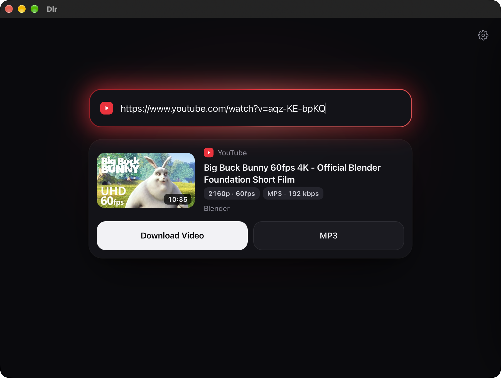

# Dlr 1.1.0

Dlr is a minimal dark-mode app for downloading videos and MP3s from YouTube, TikTok, Instagram, X,
Reddit, Facebook and [many other sites](https://github.com/yt-dlp/yt-dlp/blob/master/supportedsites.md).
Works on **Windows** and **Mac**. Free, and everything it needs is included.

Built with [yt-dlp](https://github.com/yt-dlp/yt-dlp) (as a Python library), FFmpeg and
[pywebview](https://pywebview.flowrl.com/). It only downloads: no history, no logs, no
tracking. See [SECURITY.md](SECURITY.md).



## Download and install

**1. Click the download for your computer:**

| Your computer | Download |
| --- | --- |
| **Windows 10 or 11** | [⬇ **Download for Windows**](https://github.com/Ziad-cp/Dlr/releases/latest/download/Dlr-Windows-Setup.exe) |
| **Mac with an Apple chip** (M1, M2, M3, M4…, most Macs from 2021 on) | [⬇ **Download for Mac (Apple chip)**](https://github.com/Ziad-cp/Dlr/releases/latest/download/Dlr-Mac-Apple-Silicon.dmg) |
| **Mac with an Intel chip** (older Macs) | [⬇ **Download for Mac (Intel)**](https://github.com/Ziad-cp/Dlr/releases/latest/download/Dlr-Mac-Intel.dmg) |

*Not sure which Mac you have?* Click the Apple menu (top-left corner of the screen) ›
**About This Mac**. If it says **Chip: Apple M…**, you have an Apple chip. If it says
**Processor: … Intel**, you have an Intel chip.

**2. Install it:**

<details open>
<summary><b>On Windows</b></summary>

1. Open your **Downloads** folder and double-click **Dlr-Windows-Setup.exe**.
2. Windows may show a blue box saying **"Windows protected your PC"**. This appears for apps
   from small developers that haven't paid for a Microsoft certificate. Click **More info**,
   then **Run anyway**.
3. Click **Install**, then **Finish**. No password is needed.
4. Dlr opens by itself. Next time, find it in the **Start menu** or on your **desktop**.

</details>

<details open>
<summary><b>On Mac</b></summary>

1. Open your **Downloads** folder and double-click the Dlr file you downloaded (it ends in `.dmg`).
2. A window opens: drag the **Dlr** icon onto the **Applications** folder next to it.
3. Open **Applications** and double-click **Dlr**.
4. **The first time only**, your Mac says it can't check Dlr ("Apple could not verify…").
   This appears for apps from developers who haven't paid for an Apple certificate. Click
   **Done**, then:
   - Open **System Settings** (Apple menu › System Settings) › **Privacy & Security**.
   - Scroll down to the message about Dlr and click **Open Anyway**, then **Open Anyway**
     again and enter your Mac password.
5. After that, Dlr opens normally, like any other app.

</details>

**3. Use it:** copy a video's link (from YouTube, TikTok, Instagram…), switch to Dlr (the link
fills in by itself) and click **Download Video** or **MP3**. Files go to your **Downloads** folder.

**Uninstall:** on Windows, Settings › Apps › **Dlr** › Uninstall. On Mac, drag **Dlr** from
Applications to the Trash.

## Security highlights

I built Dlr as a cybersecurity student, so every input from the internet is treated as untrusted.
The full threat model and its limits are in [SECURITY.md](SECURITY.md). In short:

- **No open ports.** The Mac app runs no web server, not even on `127.0.0.1`.
- **SSRF protection.** Links, thumbnails and redirects can never point at this computer or the
  local network; host names are resolved and checked before connecting.
- **No command injection.** Nothing runs through a shell; FFmpeg only gets argument lists and may
  read local files only.
- **XSS protection.** A strict Content-Security-Policy, and every title or name from a site is escaped.
- **Safe file names.** No path traversal, no overwriting existing files.
- **Verified updates.** New yt-dlp versions come only from the official GitHub releases and must
  match the official SHA-256 checksums, with automatic fallback.
- **Privacy.** No logs, no download history, no tracking.

## Features

- **Paste a link.** It's looked up automatically; a link on the clipboard is filled in when you
  switch to the app.
- **Glow colour.** The field's glow takes on the site's colour.
- **The card:** thumbnail, title, duration, site and quality badges, with two buttons:
  - **Download Video**: the highest quality, as an MP4 that plays in QuickTime, Photos and on
    iPhone (H.264/HEVC + AAC, metadata removed, constant frame rate up to 60 fps).
  - **MP3**: best audio, 192 kbps.
- **Pick a quality.** Tap **Download Video** again while it runs to stop it and choose one.
- **Checked files.** Every file is checked for picture and sound, with one automatic retry.
- **Queue.** Several downloads run one after another.
- **Spotify songs:** Spotify's own audio is copy-protected (DRM) and Dlr never touches it. For a
  Spotify song link, Dlr reads the song's public info (title, artist, length, cover), finds the
  same song's public upload on YouTube, downloads that, and tags the MP3 with Spotify's title,
  artist and cover art. Live versions, covers and remixes are skipped unless the Spotify title
  says so. Only single songs, no albums or playlists.
- **Clear errors.** Plain messages for private videos, logins, copy-protected services (Netflix,
  Disney+, Apple Music…), and links to your own network.
- **⚙ Settings:** download folder, yt-dlp version and update. A dot on the icon means a new
  yt-dlp is available (checked at most once a day; it never updates on its own).

## Build it yourself (for developers)

**Mac, one command:** this installs Homebrew, Python 3.12 and FFmpeg if needed, builds Dlr
on your Mac and puts it in Applications (no security warning, since your Mac built it):

```bash
/bin/bash -c "$(curl -fsSL https://raw.githubusercontent.com/Ziad-cp/Dlr/main/install.sh)"
```

<details>
<summary><b>Manual steps, Windows, and how releases are made</b></summary>

**Run from source (Mac):**

```bash
brew install python@3.12 ffmpeg
git clone https://github.com/Ziad-cp/Dlr.git && cd Dlr
python3.12 -m venv .venv && .venv/bin/pip install -r requirements.txt
.venv/bin/python app.py
```

**Run from source (Windows):** install [Python 3.12](https://www.python.org/downloads/) and
FFmpeg (`winget install Gyan.FFmpeg`), then in the Dlr folder:

```bat
py -3.12 -m venv .venv
.venv\Scripts\pip install -r requirements.txt
.venv\Scripts\python app.py
```

**Build the app:** `python build.py` makes `dist/Dlr.app` and `dist/Dlr-1.1.0.dmg` on a Mac,
or `dist\Dlr\Dlr.exe` on Windows. Run `python packaging/get_ffmpeg.py` first to include FFmpeg
in the app. On Windows, [Inno Setup](https://jrsoftware.org/isinfo.php) then makes the
installer: `iscc /DAppVersion=1.1.0 packaging\windows\dlr.iss`.

**Releases:** GitHub builds and tests the Mac and Windows apps on every push
(`.github/workflows/build.yml`). To publish a release, set `__version__` in `app.py`, then
push a matching tag. The download links above always point to the newest release:

```bash
git tag v1.1.0 && git push origin v1.1.0
```

**Command-line mode** (same code and checks, no window), from `Dlr.app/Contents/MacOS/Dlr` or
`Dlr.exe`: `--download LINK video|mp3 [FOLDER]`, `--version`, `--update-ytdlp`

</details>

## When downloads stop working

Sites change often. Open **⚙ Settings** in Dlr and click **Update**, then close and reopen Dlr.
A dot on the ⚙ icon means an update is available.

<details>
<summary>How the update works</summary>

Dlr downloads the newest yt-dlp (the part that knows how each site works) from its official
GitHub releases, checks it against the official checksums, and uses it from the next launch.
The yt-dlp built into the app stays as a fallback: if the update is damaged or won't load, Dlr
quietly goes back to it. Running from source, **Update** uses `pip install -U yt-dlp` instead.

</details>

## What it keeps

`~/Library/Application Support/Dlr/` on Mac, or `%APPDATA%\Dlr\` on Windows, holds `config.json` (your download folder) and, after an
update, the verified yt-dlp in `yt-dlp/`, plus the date of the last update check.
It keeps no history, links, titles, logs or caches. It talks only to the site you download from,
plus GitHub for yt-dlp updates (full list in [SECURITY.md](SECURITY.md)).

## Files

| File | What it does |
| --- | --- |
| `app.py` | Window (pywebview), the functions the page may call, command-line mode |
| `ui/` | The interface: `index.html`, `style.css`, `app.js` |
| `downloader.py` | Download logic: formats, checks, retry, Apple-compatible MP4 |
| `safety.py` | Link and file rules |
| `spotify.py` | Spotify song info and the matching YouTube upload |
| `config.py` | The settings file |
| `updater.py` | Verified yt-dlp updates from GitHub for the packaged app, with fallback |
| `build.py` | Builds the .app and .dmg (macOS) or the app folder (Windows) |
| `install.sh` | One-command Mac install from source: builds Dlr and puts it in Applications |
| `packaging/` | App icons, the script that draws them, `get_ffmpeg.py` (fetches a checked FFmpeg for the app) and the Windows installer script |
| `.github/workflows/build.yml` | Builds, tests and publishes the Mac and Windows downloads |

## Notes

- Only download videos you have the right to download.
- Private videos, videos behind a login, and copy-protected services can't be downloaded.
- Spotify links download the matching public YouTube upload, never Spotify's own audio.

## License

[MIT](LICENSE) © 2026 Ziad Gahlan. Dlr uses [yt-dlp](https://github.com/yt-dlp/yt-dlp)
(Unlicense), [pywebview](https://github.com/r0x0r/pywebview) (BSD) and [FFmpeg](https://ffmpeg.org),
each under its own license. The downloadable apps include an FFmpeg build licensed under the
GPL v3; its notice and source details ship inside the app (`FFmpeg-NOTICE.txt` on Mac,
`_internal\ffmpeg\NOTICE.txt` on Windows).
