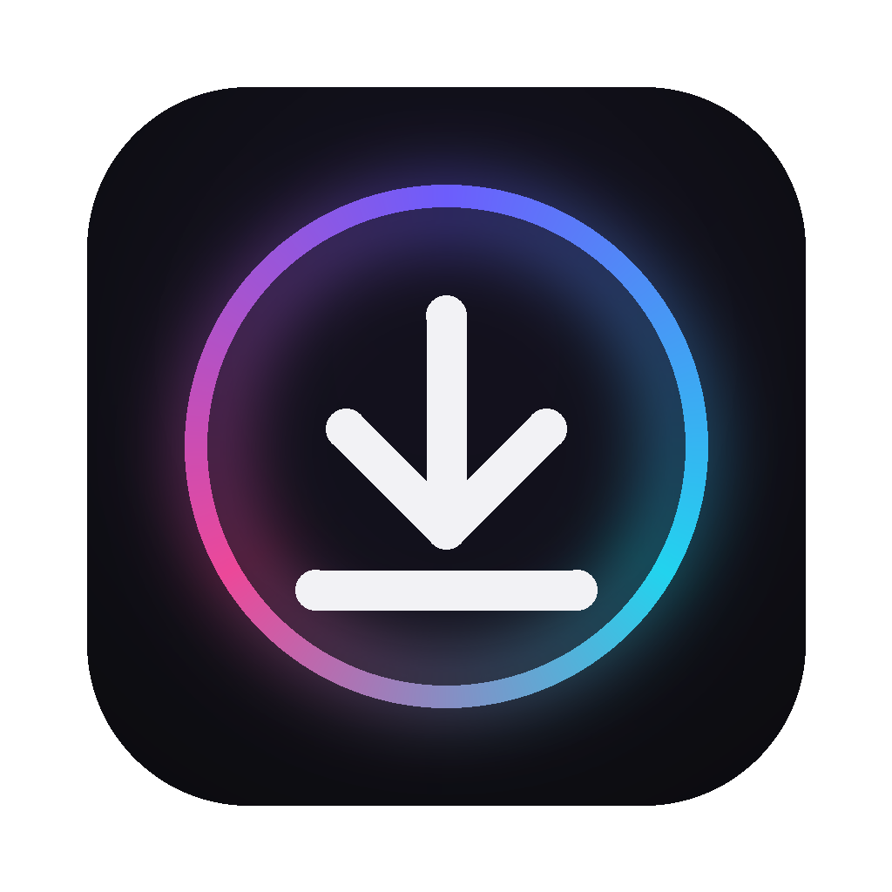

# Dlr

**Download videos and audio from YouTube, TikTok, Instagram and 1,000+ other sites.**

## Download

| Platform | Download | Requires |
| --- | --- | --- |
| **Windows** | [Dlr-Windows-Setup.exe](https://github.com/Ziad-cp/Dlr/releases/latest/download/Dlr-Windows-Setup.exe) | Windows 10 or 11 |
| **macOS** (Apple silicon) | [Dlr-Mac-Apple-Silicon.dmg](https://github.com/Ziad-cp/Dlr/releases/latest/download/Dlr-Mac-Apple-Silicon.dmg) | M1 or newer |
| **macOS** (Intel) | [Dlr-Mac-Intel.dmg](https://github.com/Ziad-cp/Dlr/releases/latest/download/Dlr-Mac-Intel.dmg) | Intel Mac |
| **Android** | [Dlr-Android.apk](https://github.com/Ziad-cp/Dlr/releases/latest/download/Dlr-Android.apk) | Android 10 or newer |

Everything is included: no extra software to install. Older 32-bit Android phones:
[Dlr-Android-32-bit.apk](https://github.com/Ziad-cp/Dlr/releases/latest/download/Dlr-Android-32-bit.apk).
All versions are on the [releases page](https://github.com/Ziad-cp/Dlr/releases).

> [!NOTE]
> Dlr isn't signed with a paid Apple or Microsoft certificate, so your system asks you to
> confirm the first launch:
> - **Windows:** on "Windows protected your PC", click **More info › Run anyway**.
> - **macOS:** open Dlr once, then go to **System Settings › Privacy & Security** and click
>   **Open Anyway**.
> - **Android:** allow installing from your browser when asked. If Play Protect warns you,
>   choose **More details › Install anyway**.

## Features

- **Paste and go.** Copy a link and switch to Dlr: it fills in and looks up the video by itself.
- **Video or MP3.** Highest-quality MP4 that plays everywhere (including iPhone), or 192 kbps MP3.
- **Choose a quality.** Best available, 1080p or 720p.
- **Android share menu.** In any app, tap **Share › Dlr**.
- **Spotify songs.** Finds the matching public YouTube upload and tags the MP3 with the song's
  title, artist and cover art.
- **Queue.** Add several links; they download one after another.
- **Checked files.** Every file is checked for picture and sound, with an automatic retry.
- **Private.** No account, no history, no logs, no tracking.

## iPhone and iPad

There's no iOS version. Apple only allows apps from the App Store, which doesn't permit video
downloaders, and the other routes (sideloading, alternative stores) expire, cost money or are
limited to some countries. Download on your computer instead: Dlr's MP4s play natively on
iPhone. Send them over AirDrop, or save them to iCloud Drive and use **Save Video** in Files.

## Keeping it working

Sites change often. If downloads start failing, open **Settings › Update** in Dlr (or tap
**Update** on Android). A dot on the Settings icon means a new version of the download engine
is available. Updates come only from the official [yt-dlp](https://github.com/yt-dlp/yt-dlp)
releases and are verified before use.

## Security and privacy

Dlr treats everything from the internet as untrusted:

- No open network ports; the app runs no web server.
- Links can never reach your computer or local network (SSRF protection).
- Nothing runs through a shell; downloaded files can't overwrite your files.
- Updates and the bundled FFmpeg are verified against official checksums or signatures.

It stores only your download folder setting. Details, limits and the full list of network
connections: [SECURITY.md](SECURITY.md).

## Building from source

See [docs/BUILDING.md](docs/BUILDING.md) for running from source, building each app, the test
setup and publishing releases.

## License

[MIT](LICENSE) © 2026 Ziad Gahlan. Built on [yt-dlp](https://github.com/yt-dlp/yt-dlp),
[FFmpeg](https://ffmpeg.org) and [pywebview](https://pywebview.flowrl.com/). The released apps
bundle GPL-licensed components (FFmpeg, and
[youtubedl-android](https://github.com/yausername/youtubedl-android) on Android), so those
binaries are distributed under the GPL v3. License notices ship inside each app.

Only download content you have the right to download. Private, login-only and copy-protected
(DRM) videos aren't supported.
