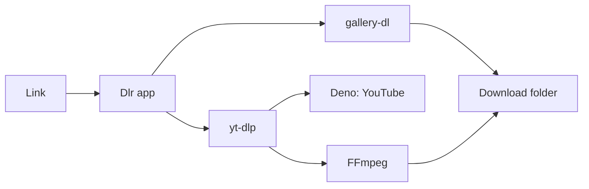

# Dlr

**Paste a link. Pick a quality. Done.**

A fast, private downloader for Mac. Save videos, photos and music 
from YouTube, TikTok, Instagram, Spotify and 1,000+ other sites.

 

Free and open source · Apple Silicon (M1 or newer) · macOS 12 Monterey or newer

  

 

## Highlights

<table>
<tr>
<td width="33%" valign="top">

**One step** 
Copy a link and switch to Dlr. The link fills in, a preview appears, and one click saves it.

</td>
<td width="33%" valign="top">

**Real quality** 
Only the qualities a video actually has, saved as an MP4 that plays on any Mac, iPhone or app.

</td>
<td width="33%" valign="top">

**Private by design** 
No account, no tracking, no download history. Everything runs locally on your Mac.

</td>
</tr>
</table>

## Supported sites

| Site | What you can save | Login required |
| --- | --- | --- |
| **YouTube** | Videos in any available quality, MP3 | Only for private, age-restricted or "confirm you're not a bot" videos |
| **TikTok** | Videos without watermark, photo slideshows with sound | No |
| **Instagram** | Reels, video posts, share links | For photo posts, carousels and stories |
| **Spotify** | Songs, albums and playlists (first 100 songs) as tagged MP3s | No |
| **X** | Videos | No |
| **Facebook** | Public videos | No |
| **Pinterest** | Video and image pins | No |
| **Reddit** | Videos with sound, galleries | Usually: Reddit refuses most signed-out downloads |
| **1,000+ others** | Anything [supported by yt-dlp](https://github.com/yt-dlp/yt-dlp/blob/master/supportedsites.md) | Depends on the site |

> [!NOTE]
> Logins are off by default. When a site requires one, Dlr says so. You can enable it in **Settings › Logins from** by choosing the browser you're signed in with.

## Usage

1. **Copy** a link to a video, post, song, album or playlist.
2. **Switch to Dlr.** The link is filled in and a preview card appears.
3. Click **Download Video** for the best quality, or **MP3**. To pick another quality, click **Download Video** again while it runs.
4. Click **Show in Finder** when it's finished.

Files are saved to your **Downloads** folder by default (**Settings › Save downloads to**). Existing files are never overwritten.

## Features

| | |
| --- | --- |
| **Video that plays everywhere** | H.264 MP4 when the site offers it, otherwise the best version converted. Every file is checked for picture and sound. |
| **MP3 at 320 kbps** | From any video or song. Spotify downloads include title, artist, album and cover art. |
| **Photos and carousels** | Photo posts, carousels and TikTok slideshows, saved as one folder per post. |
| **Spotify albums and playlists** | Each song matched and saved as its own tagged MP3, grouped in one folder. |
| **Self-updating engines** | yt-dlp and gallery-dl update from their official releases and are verified before use. |
| **Nothing kept** | No history, logs or telemetry. Every launch starts with an empty window. |

## Download

**[Download Dlr for Mac](https://github.com/Ziad-cp/Dlr/releases/latest/download/Dlr-mac-apple-silicon.dmg)** · Requires Apple Silicon (M1 or newer) and macOS 12 Monterey or newer.

Everything Dlr needs is bundled inside the app. There's nothing else to install.

<b>First launch</b>

 

Dlr isn't notarized by Apple, so macOS asks for confirmation the first time.

1. Open the downloaded file and drag **Dlr** into **Applications**.
2. Open Dlr. When macOS says it can't verify the app, click **Done**.
3. Go to **System Settings › Privacy & Security**, scroll down and click **Open Anyway** next to "Dlr was blocked".
4. Enter your password and click **Open**. Dlr opens normally from then on.

## FAQ

<b>Is Dlr free?</b>

 
Yes. It's free and open source, with no ads and no account.

<b>Where are my files saved?</b>

 
In your <b>Downloads</b> folder by default. You can change this in <b>Settings › Save downloads to</b>. Photo posts, albums and playlists each get their own folder.

<b>Why does macOS block Dlr the first time?</b>

 
Dlr isn't notarized by Apple, which requires a paid Apple Developer account. Follow the <b>First launch</b> steps once and it will open normally afterwards.

<b>Why do Reddit and some Instagram posts require a login?</b>

 
These sites refuse downloads from signed-out visitors. Enable <b>Settings › Logins from</b> and choose the browser you're signed in with. Using a separate account rather than your main one is recommended.

<b>How do Spotify downloads work?</b>

 
Spotify's own audio is copy-protected. Dlr reads the track details from the Spotify link, finds the same song on YouTube Music (or YouTube) and saves it as a 320 kbps MP3 with title, artist, album and cover art. Playlists are limited to the first 100 songs.

<b>Does Dlr run on Intel Macs or Windows?</b>

 
No. Current versions support Apple Silicon Macs (M1 or newer) only.

 

---

## Technical details

### Security

| Area | Implementation |
| --- | --- |
| **Signed updates** | yt-dlp updates are taken only from its GitHub releases and must carry a valid OpenPGP signature from yt-dlp's release key, which is pinned in the app. gallery-dl updates are taken only from PyPI and must match PyPI's SHA-256. |
| **Pinned tools** | FFmpeg and Deno are never updated by the app. They are pinned at build time to exact versions and SHA-256 checksums. |
| **No shell execution** | FFmpeg, gallery-dl and Dlr's own helper run with fixed argument lists, never through a shell. |
| **Restricted UI bridge** | The app window can call only 11 named functions, none of which runs a command. Website text is always rendered as plain text, and a Content Security Policy allows only the app's own scripts. |
| **Contained file paths** | File and folder names derived from titles are sanitized so they cannot point outside the download folder, which only the user selects. |
| **Privacy** | No history, logs, analytics or telemetry. Browser logins are read only when enabled. |

The full threat model, every network connection and known limitations are documented in **[SECURITY.md](SECURITY.md)**.

### Architecture

Dlr is a native window built with [pywebview](https://pywebview.flowrl.com) around [yt-dlp](https://github.com/yt-dlp/yt-dlp), with [FFmpeg](https://ffmpeg.org), [Deno](https://deno.com) and [gallery-dl](https://github.com/mikf/gallery-dl) bundled inside. There is no Dlr server. The app connects only to the site you download from (for Spotify links, also YouTube Music and YouTube to match each song) and to GitHub and PyPI to check for engine updates.

### Building from source

Requires Python 3.12 on an Apple Silicon Mac. See [docs/BUILDING.md](docs/BUILDING.md).

### Credits

Built on [yt-dlp](https://github.com/yt-dlp/yt-dlp), [gallery-dl](https://github.com/mikf/gallery-dl), [FFmpeg](https://ffmpeg.org), [Deno](https://deno.com) and [pywebview](https://pywebview.flowrl.com).

### License

Only download content you have the right to download, and respect each site's terms of service. DRM-protected services such as Netflix are not supported.

Dlr's source code is released under the [MIT License](LICENSE). The distributed app bundles GPL-licensed components (FFmpeg, gallery-dl), whose licenses are included inside the app.

 

© Ziad Gahlan

