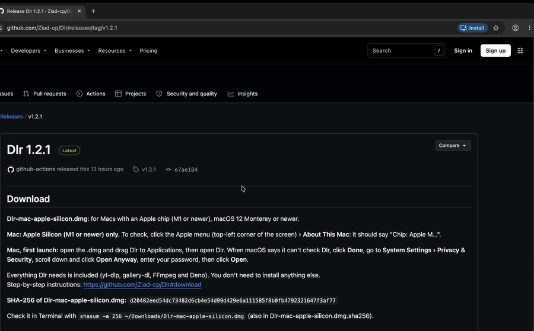

# Dlr

**Paste a link. Pick a quality. Done.**

 

## Download for Mac

**[⬇ Download Dlr for Mac](https://github.com/Ziad-cp/Dlr/releases/latest/download/Dlr-mac-apple-silicon.dmg)**

Apple Silicon (M1+) · macOS 12+

**Works with:** YouTube · TikTok · Instagram · X · Facebook · Pinterest · Spotify

## Features

- **Best quality that plays everywhere:** an MP4 for any app or device, or pick another quality.
- **MP3 at 320 kbps** from any video or song.
- **Photos and carousels:** photo posts and TikTok slideshows, saved as one folder.
- **Spotify albums and playlists:** every song as a tagged MP3.
- **No history:** no account, no tracking, nothing kept about what you download.

<b>First launch</b> (macOS asks once)

1. Open the downloaded file and drag **Dlr** into **Applications**.
2. Open Dlr. macOS says it can't check it, because Dlr isn't notarized by Apple. Click **Done**.
3. Open **System Settings › Privacy & Security**, scroll down and click **Open Anyway** next to
   "Dlr was blocked".
4. Enter your password and click **Open**. From now on Dlr opens normally.

---

## How it's secure

- **Verified updates from official sources.** yt-dlp updates come only from its GitHub releases
  and must carry a valid OpenPGP (GPG) signature from yt-dlp's release key, which is pinned in the
  app. gallery-dl updates come only from PyPI and must match the SHA-256 that PyPI lists. FFmpeg
  and Deno are never updated by the app: they're pinned at build time to exact versions and
  SHA-256 checksums.
- **No shell commands.** FFmpeg, gallery-dl and Dlr's own download helper are started with fixed
  argument lists, never through a shell. The app window can call only 11 named functions, and
  none of them runs a command.
- **Downloads stay in your download folder.** File and folder names made from titles are cleaned
  so they can't point outside it, and only you choose the folder, in the Mac's own folder picker.
- **No history or tracking, logins off by default.** No download history, logs, analytics or
  telemetry. Dlr reads a browser's logins only if you choose one in **Settings › Logins from**.
- **Titles can't inject code into the app window.** Text from websites is always shown as plain
  text, never as HTML, and the window's Content Security Policy runs only the app's own scripts.

Details, the full list of network connections and the known limits: [SECURITY.md](SECURITY.md).

## How it works

Dlr is a small native window around [yt-dlp](https://github.com/yt-dlp/yt-dlp), with
[FFmpeg](https://ffmpeg.org), [Deno](https://deno.com) and
[gallery-dl](https://github.com/mikf/gallery-dl) bundled inside, so there's nothing else to
install. Everything runs locally on your Mac. There's no Dlr server: Dlr connects only to the
site you download from (for Spotify links, also YouTube Music and YouTube to find each song) and
to GitHub and PyPI to check for yt-dlp and gallery-dl updates.

## Build from source

See [docs/BUILDING.md](docs/BUILDING.md).

---

Personal use only · <a href="LICENSE">MIT License</a>

